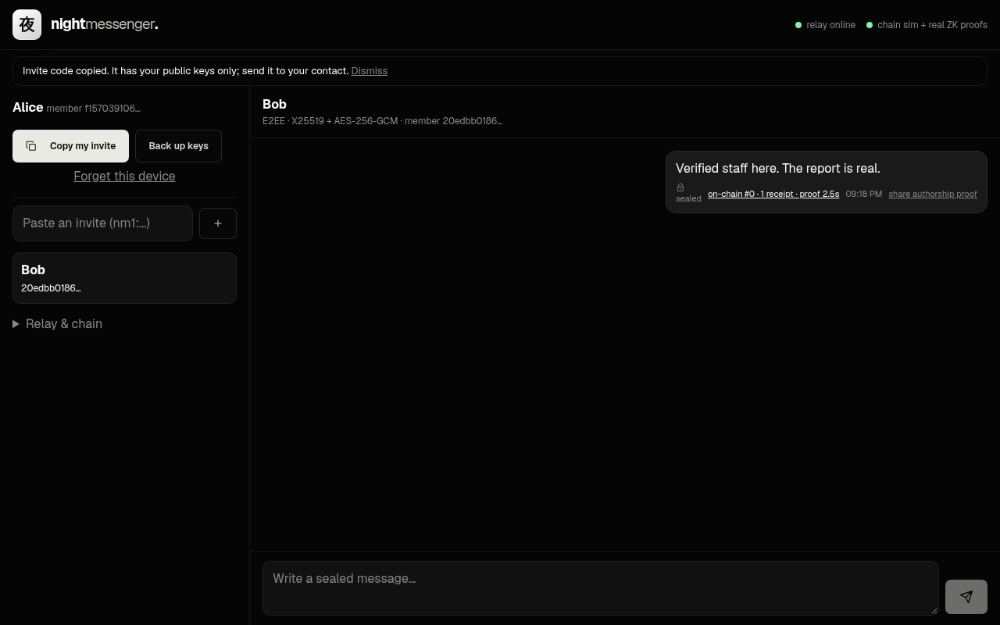

# Night Messenger

**Verified, but anonymous. Private messages with delivery receipts anyone can check.**

Night Messenger is an open-source messenger for the [Midnight](https://midnight.network) blockchain, built by **Kshot Applications**.

- **Verified but anonymous senders.** A sender proves in zero knowledge that they are a registered member of a conversation (for example, verified staff writing to a tip line) without revealing which member.
- **Delivery receipts anyone can check.** The recipient posts an anonymous delivery receipt (`ackDelivery`) against the message's on-chain commitment. Anyone can look a commitment up at `/verify` and see that a member posted it and how many members acknowledged it, without seeing the message, the sender or the recipient.
- **Real end-to-end encryption in the browser.** Keys are made on your device; the relay only ever stores ciphertext.

> ⚠️ **Testnet only. Not audited.** The contract and encryption code have not had a security review. Use test identities and sample content only.
>
> **Status (Nov 2026, Wave 3 build):** encryption, relay delivery, the Compact contract and its ZK proofs all work locally. The web demo's "chain" is a **local chain simulator** that runs the real compiled contract (and, with a proof server, real proofs). **The contract is not yet deployed to Midnight Preprod**; see [Preprod status](#preprod-status).

[Live site (static pages)](https://kshot3000.github.io/Night-Messenger-/) · [X: @kshot9000](https://x.com/kshot9000) · [Privacy model](#privacy-model) · [What changed this Wave](#what-changed-this-wave)



The product name lives in one constant, `PRODUCT.name` in `packages/shared/src/product.ts`; the UI reads it from there.

---

## Why it matters

**Delivery you don't have to take on trust.** In most apps, "delivered" is whatever the server says. Here each message leaves a 32-byte fingerprint (a SHA-256 commitment of its ciphertext) on-chain, and the recipient posts a receipt against it. Anyone can recompute the fingerprint from the ciphertext the relay handed over, so the relay cannot swap or edit a message without it showing, and a missing receipt is visible.

**Proof you belong, without giving up who you are.** A whistleblower who really works at the company, a verified customer, a staff member on a tip line: each can prove "I'm one of the members" without "I'm Alice". The recipient, after decrypting, can still confirm which member wrote it, and either side can later hand a third party a proof of authorship for **one** message without opening any other.

## How it works

1. **Make keys.** Your browser generates an X25519 key pair and a separate 32-byte Midnight member secret. You share an invite code (public keys only) with your contact.
2. **Write.** Your browser seals the message for the recipient. Only the 32-byte commitment of the ciphertext goes on-chain, via `postEnvelope`, with a ZK proof that you hold a member leaf of the conversation's inbox. The proof does not say which leaf.
3. **Deliver.** A small relay stores the sealed envelope in the recipient's mailbox. It can't read it and can't see who sent it.
4. **Confirm.** The recipient decrypts, checks the sender's key against the invite, checks the on-chain author tag, and posts `ackDelivery`: an anonymous one-per-member receipt. Anyone can count receipts at `/verify`.

```mermaid
sequenceDiagram
    participant S as Sender (browser)
    participant R as Relay (ciphertext only)
    participant C as night_messenger contract
    participant V as Recipient (browser)
    participant P as Anyone

    S-->>V: invite codes swapped (public keys only)
    S->>C: createInbox + addMember x2 (first message only; only salted leaves public)
    Note over S: seal: X25519 + HKDF + AES-256-GCM
    S->>R: sealed envelope (sender key encrypted inside)
    S->>C: postEnvelope(inbox, commitment) + ZK proof "a member of this inbox"<br/>stores hiding author tag
    R->>V: sealed envelope
    Note over V: open, check sender key = invite,<br/>recompute commitment + author tag = ledger
    V->>C: ackDelivery(commitment) + ZK proof, one-time nullifier
    P->>C: /verify: posted? how many receipts?
```

## What works today

| Area | Status |
| --- | --- |
| E2EE in the browser (`/private`) | ✅ X25519 + HKDF-SHA-256 + AES-256-GCM via the browser's built-in **WebCrypto** (no third-party crypto library), Noise-X-style sealed envelopes |
| Keys at rest | ✅ sealed with a non-extractable AES-GCM device key kept in IndexedDB; passphrase backup/restore (PBKDF2-SHA-256, 600k iterations) |
| Delivery between two browsers | ✅ tiny zero-dependency Node relay (`apps/relay`) |
| Compact contract | ✅ `contracts/src/night_messenger.compact`, compactc **0.31.1**, 7 circuits |
| ZK proofs | ✅ every circuit proves against proof server 8.1.0 (`docs/local-proofs.json`; 4,508-byte proofs, `postEnvelope` ≈ 2–5 s) |
| Anonymous sender, recipient verification, per-message authorship disclosure | ✅ |
| Public receipt check (`/verify`) | ✅ against the local chain simulator |
| Usage counts (registrations, envelopes, receipts) | ✅ ledger counters, shown on `/verify` and via `pnpm stats` |
| Midnight Preprod deployment | ❌ not yet: needs a funded Preprod wallet ([below](#preprod-status)) |
| Lace wallet signing from the browser | ❌ next phase (wallet detection exists) |
| First message free via DUST sponsorship | ❌ stretch goal, not started |

The older sample messenger at `/app` (search, pins, reactions, backup) is still a **local, unencrypted preview** with demo data and is labelled as such.

## Quick start (local demo, two browsers)

Requires Node.js 24 LTS (minimum 22.18) and pnpm 11.25.0. The web demo, relay and tests need **no Docker and no wallet**. The Compact compiler is only needed to rebuild the contract; a proof server is optional (it turns simulated calls into real ZK proofs).

```bash
git clone https://github.com/Kshot3000/Night-Messenger-.git
cd Night-Messenger-
npm install -g pnpm@11.25.0
pnpm install --frozen-lockfile

# 1. Compile the contract (Compact toolchain, compiler 0.31.1)
#    curl --proto '=https' --tlsv1.2 -LsSf https://github.com/midnightntwrk/compact/releases/latest/download/compact-installer.sh | sh
#    compact update 0.31.1
pnpm compile:contracts            # full build with proving keys (~25 s)

# 2. Optional: a local proof server for real ZK proofs (Docker)
docker run -p 6300:6300 midnightntwrk/proof-server:8.1.0

# 3. In three terminals:
pnpm relay                                              # ciphertext relay on :8787
NM_PROOF_SERVER=http://localhost:6300 pnpm chain-sim     # contract simulator on :8788 (omit the env var for no proofs)
pnpm dev                                                # web app on :3000
```

Open `http://localhost:3000/private/` in two browser profiles (or one normal and one private window). Create keys in each, copy each invite into the other, and send a message. Within a few seconds the sender sees `on-chain #n · 1 receipt`; click it to open the public `/verify` view.

Terminal-only version of the same flow (E2EE → relay → contract → receipt → disclosure):

```bash
pnpm demo:e2e
```

### Checks

```bash
pnpm test             # E2EE, relay, private-chat state, and existing web tests (no compiler needed)
pnpm test:contracts   # compiles with --skip-zk, then simulator tests for every circuit + chain simulator
pnpm typecheck        # web and shared packages
pnpm lint             # web source
pnpm build:web        # static export
pnpm --filter @midnight-messenger/contracts prove:local   # real proofs; needs step 1 + 2
pnpm --filter @midnight-messenger/contracts stats -- --sim http://localhost:8788
```

The `Web checks` GitHub Actions workflow (`.github/workflows/web-checks.yml`) runs `pnpm test`, `pnpm typecheck`, `pnpm lint` and `pnpm build:web` on every main-branch push and pull request. Contract tests need the Compact compiler and are run locally.

Relay and chain URLs default to `http://localhost:8787` and `http://localhost:8788`; change them under **Relay & chain** in the app, or at build time with `NEXT_PUBLIC_NM_RELAY_URL` / `NEXT_PUBLIC_NM_CHAIN_URL`. Remote endpoints must be `https://`.

## Architecture

| Part | Folder | What it does | License |
| --- | --- | --- | --- |
| Web app | `apps/web` | Next.js 15 / React 19. `/private` (E2EE chat), `/verify` (public receipts), plus the older `/app` sample preview | MIT; new private-chat files Apache-2.0 (SPDX headers) |
| Encryption | `packages/shared/src/e2ee.ts` | Identities, invites, seal/open, author tags, backups. WebCrypto only | Apache-2.0 |
| Relay | `apps/relay` | Zero-dependency mailbox server for sealed envelopes | Apache-2.0 |
| Contract | `contracts/src/night_messenger.compact` | Inboxes, member tree, `postEnvelope`, `ackDelivery`, `revealAuthor`, counters | Apache-2.0 (`contracts/LICENSE`) |
| Chain simulator | `contracts/sim` | Runs the compiled contract over HTTP for the demo; optional real proofs | Apache-2.0 |
| Preprod drill | `contracts/preprod` | Deploy + post + ack script (not run yet) | Apache-2.0 |
| Mobile starter | `apps/mobile` | Earlier Expo starter, not part of this release. The web app will later be wrapped with Capacitor | MIT |

**Stack:** Compact compiler 0.31.1 · `@midnight-ntwrk/compact-runtime` 0.16.0 · midnight-js 4.1.1 (proof provider) · proof server 8.1.0 · Next.js 15 · React 19 · TypeScript · Node 24.

## Contract functions

| Circuit | Who calls it | Public on the ledger | Stays private |
| --- | --- | --- | --- |
| `createInbox(inboxId)` | inbox owner (first sender of a DM) | inbox id, owner commitment | owner secret |
| `addMember(inboxId, member)` | owner | a salted leaf `H(inbox, member)`; member count | the member commitment itself (circuit argument, never disclosed) |
| `removeMember` / `closeInbox` | owner | slot emptied, root history reset / inbox closed | same |
| `postEnvelope(inboxId, commitment)` | any member | commitment, inbox id, Merkle root, hiding author tag, sequence number | which member, the member secret, the blind, the message |
| `ackDelivery(commitment)` | any member of the post's inbox | commitment, one-time nullifier `H(commitment, sk)`, receipt count | which member, their secret |
| `revealAuthor(commitment)` | the author, opt-in | the author's member commitment for that one message | everything else |

Usage counters on the ledger: `inboxCount`, `membersAdded` (registrations), `postCount` (envelopes posted), `deliveryCount` (receipts). They are aggregate totals only.

## Privacy model

| Data | Where it lives | Who can see it |
| --- | --- | --- |
| Message text | Sender's and recipient's browsers (sealed at rest) | Sender and recipient |
| Sealed envelope | Relay, up to 7 days (`NM_RELAY_TTL_HOURS`) | Anyone holding it sees ciphertext only; the sender's key is encrypted inside |
| Commitment (SHA-256 of the envelope) | On-chain | Everyone; reveals nothing about content |
| Membership proof | On-chain | Everyone can verify "a member of inbox X posted this", not which member |
| Member leaves | On-chain | Everyone sees salted hashes; not reversible to members |
| Author tag | On-chain | Hiding; only someone given `(member, blind)` can check it |
| Delivery receipt nullifier | On-chain | Everyone; unlinkable to a member without their secret |
| Public encryption key, member commitment | Invite code you choose to share | Your contacts (not on-chain) |
| Secret keys | Your browser only | Only you |

**Does `postEnvelope` or `ackDelivery` reveal the recipient on-chain?** No. Neither circuit takes or discloses the recipient's key, mailbox or member commitment. `postEnvelope` discloses the inbox id (for a DM, a hash of both member commitments, so it links messages of the same conversation but names nobody), and `ackDelivery` discloses only the commitment and a one-time nullifier. Caveat: in a two-person DM the anonymity set is two, so "a member other than the sender acknowledged" effectively means "the other party", pseudonymously.

**Known limits:**

- **Metadata at the relay.** The relay sees the recipient's mailbox id (a hash of their public key), envelope sizes, timing and IP addresses. Use Tor or a VPN if that matters. It keeps no request log.
- **Chain simulator trust.** The local simulator, like Midnight's proof server, receives your private circuit inputs to run the circuit, so it must run on your own machine (it binds to 127.0.0.1). On Preprod those inputs go only to your local proof server.
- **Small sets.** With few members, "one of the members" hides little. Receipts are capped at one per member, but a sender can also acknowledge their own message.
- **No forward secrecy** if a recipient's long-term key leaks later; single device, manual backup; no audit.
- **Invite exchange** is manual (copy/paste); verify invites out of band.

## Preprod status

Not deployed yet. **Contract address: none.** The deploy-and-drill script (`contracts/preprod/night-messenger-preprod.mjs`, same pattern as our earlier ShieldPass Preprod deploy) needs:

1. A Preprod wallet seed or mnemonic in `MIDNIGHT_WALLET_SEED` / `MIDNIGHT_WALLET_MNEMONIC`, funded with tNIGHT from the Midnight Preprod faucet, with tDUST registered.
2. A Blockfrost Midnight Preprod project id (`BLOCKFROST_MIDNIGHT_PREPROD_ID`) or another indexer URL.
3. A running proof server 8.1.0 and the full ZK build (`pnpm compile:contracts`).

When it runs, `deployments/preprod.json` records the address and `https://preprod.midnightexplorer.com/contracts/0x…` links.

## Testnet and audit status

- Local demo and (soon) Midnight Preprod only. No mainnet deployment.
- **Not audited.** Treat every privacy property here as a design goal under test.
- Report security issues privately through GitHub Security Advisories on this repo, not in public issues.

## Licensing

- New Midnight code (the Compact contract, simulator, Preprod scripts, relay, `packages/shared/src/e2ee.ts`, and the private-chat web files marked `SPDX-License-Identifier: Apache-2.0`) is **Apache-2.0** (see `contracts/LICENSE`).
- Everything else stays **MIT** (see `LICENSE`).

## Related work

Several teams are building private messaging on Midnight, which is good for everyone. Summaries below come from each project's public posts (Nov 2026) and are not claims about what they can or can't do; open an issue if we got something wrong.

| Project | Public description | Where Night Messenger differs |
| --- | --- | --- |
| **Midnight Messenger** ([@EnigmA_SPO](https://x.com/EnigmA_SPO)) | Preprod beta; MLS end-to-end encryption, sponsor-paid signup, username plus 6-digit code over a hashed directory, ciphertext-only relay | Recipient-posted delivery receipts anyone can check on-chain, and per-message authorship disclosure |
| **Vale** | Wallet-based identity and private discovery; chat off-chain | On-chain checkable receipts |
| **ZK-Chat** | Encrypted chat with ZK proofs of sender authenticity | Recipient-posted receipts |
| **ZKMail** | Developer framework for confidential, ZK-verified messaging | End-user app built around checkable receipts |

## Roadmap

**Wave 3 (target Nov 25, 2026):** deploy to Preprod, switch `/verify` and `/private` from the simulator to Lace + proof server + indexer, demo video. Stretch: first message free via DUST sponsorship.

**Next:** tester round, security review, multi-device keys and recovery, group inboxes in the UI (the contract already supports them), Android app via Capacitor, mainnet only after an audit.

**Product idea (not built, nothing for sale):** a verified tip line / Teams edition for organisations.

## What changed this Wave

**Before:** a local UI preview. No encryption, no delivery, `contracts/` was an unimplemented stub.

**Now:**

- Compact contract with anonymous membership posting, author tags, anonymous one-per-member delivery receipts, opt-in author reveal, member removal and usage counters; simulator tests for every circuit.
- Real ZK proofs for every circuit against proof server 8.1.0.
- In-browser E2EE with keys sealed at rest (folding in the useful parts of the earlier [Nocturne](https://github.com/Kshot3000/nocturne) preview: device-key sealing and passphrase wrapping).
- Ciphertext-only relay, local chain simulator, `/private` and `/verify` pages, terminal demo.
- Apache-2.0 for the new Midnight code.
- Not yet: Preprod deployment, Lace signing, DUST sponsorship, tester round.

---

Built by **Kshot Applications** · [kshot.tech](https://kshot.tech) · [@kshot9000](https://x.com/kshot9000) · Topic: `midnightntwrk`

## Support the dev

Our apps are free and open source. If this one helps you, you can tip in ADA:

`addr1q8hnl6vl5a6k3rw3n5g3jtte696zcl76kfatzv7gpswa9r0dj7fma6klq55y4ffm7tf0em09udnyhuk4ah92pl5x9jpqjae44v`

Tips are optional and unlock nothing: no support, features or return. Always check the address before you send.
